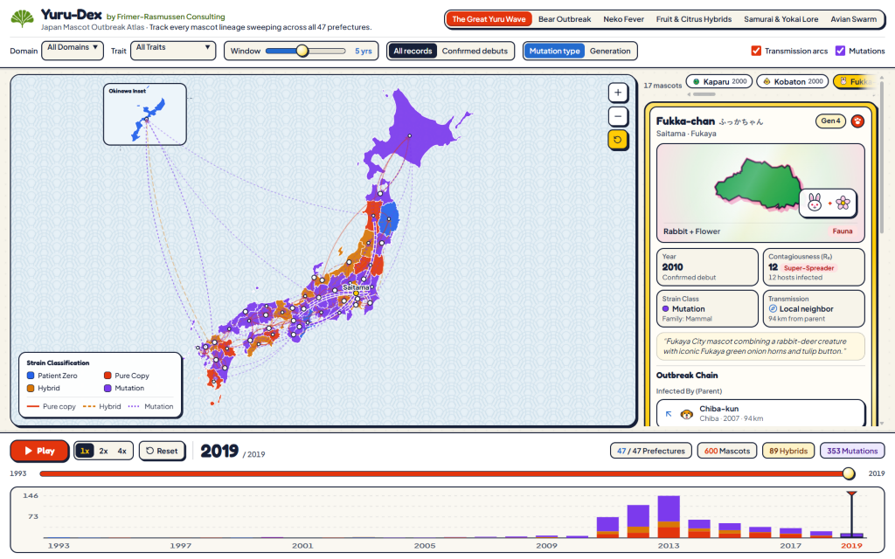
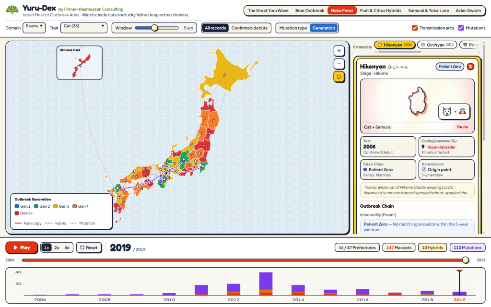
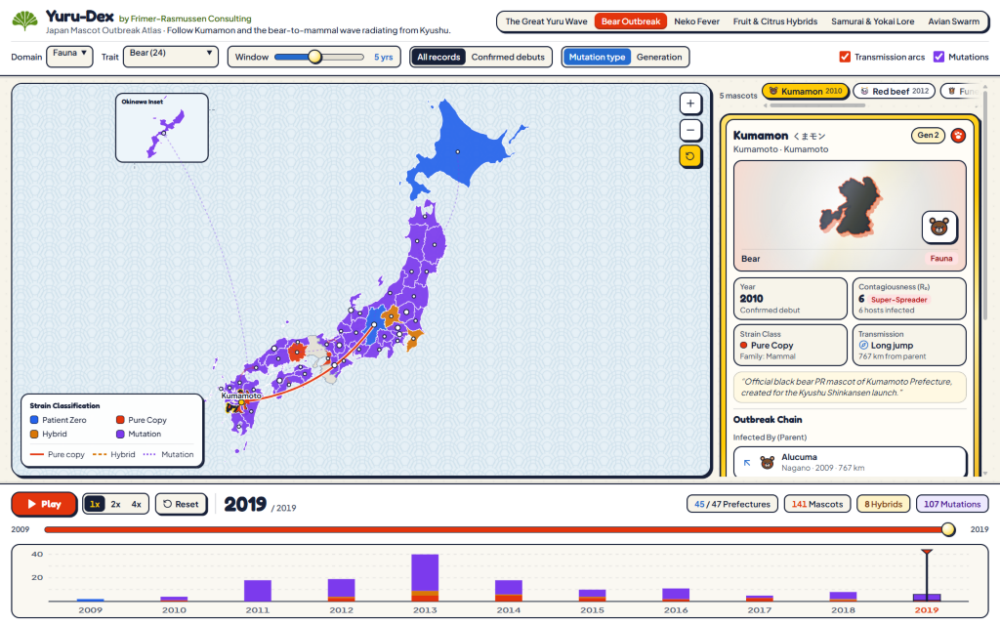
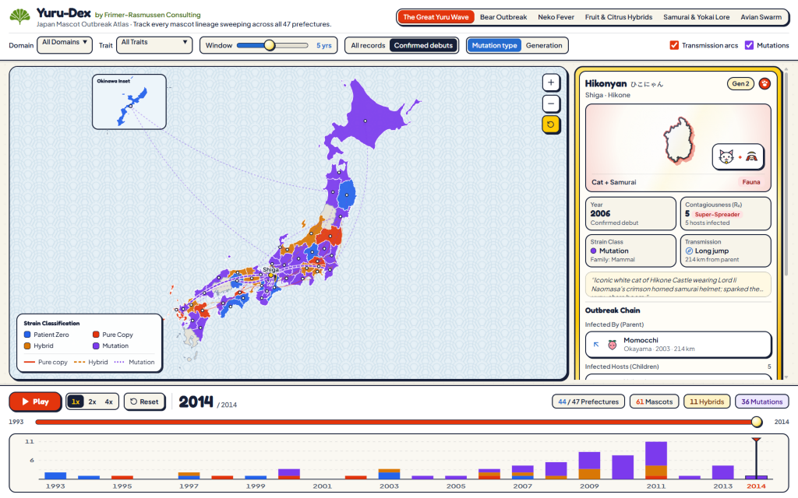

# What If Japan's Mascots Were a Contagious Virus?

### Modeling 600 real *yuru-chara* like a Pokémon-styled trait epidemic reveals why fame doesn't make a super-spreader, why cats crawl while birds teleport, and why Japan's mascot boom looks like a surveillance artifact.

Between 1993 and 2019, Japan caught a joyful fever. Towns, castles, train lines, and citrus cooperatives began inventing *yuru-chara*—"loose" regional mascots designed to charm tourists and sell local specialties. Before long, every prefecture from Hokkaido to Okinawa had bears, samurai cats, onion-horned rabbits, and melon-headed monsters waving at commuters.

I built **[Yuru-Dex](https://github.com/MiFriRa/frc-yuru-chara)** purely for fun: an interactive Pokémon-inspired field guide that treats regional mascot traits as an infectious outbreak spreading across Japan's 47 prefectures. Underneath the playful Pokédex aesthetic sits a real, deterministic epidemiological model running across **600 real Japanese mascots**.

Treating culture like contagion sounds silly—until you run the numbers like an epidemiologist. Three genuinely non-obvious patterns jump straight off the map, and you can reproduce every single one of them interactively in the app.

---

## Treating *Kawaii* as a Contagion

To turn mascot history into an outbreak model, every character is decoded into structured "DNA":

- **5 Elemental Domains:** *Fauna*, *Flora & Food*, *Lore & History*, *Geo & Nature*, and *Object & Abstract*.
- **32 Normalized Traits & 10 Trait Families:** A bear (`bear`) and a raccoon (`raccoon`) belong to the *mammal* family; a citrus fruit (`citrus`) and a melon (`melon`) belong to *fruit*; a samurai and a ninja share *warrior*.
- **Deterministic Lineage Rules:** When a mascot appears in year $t$, the engine scans a configurable lookback window ($t - \text{window}$ to $t - 1$, default **5 years**) for the geographically closest ancestor sharing a trait or trait family—**prioritizing direct neighboring prefectures** (including bridges, tunnels, and ferry links like Seikan and Seto Ohashi) over distant jumps.

From there, every mascot receives an epidemiological classification:

- **Patient Zero (Gen 1):** No matching ancestor exists within the transmission window.
- **Pure Copy:** Same primary trait as its parent, with no added hybrid features.
- **Hybrid:** Inherits the parent's trait while fusing new secondary traits (e.g., *Cat + Samurai* or *Bear + Melon*).
- **Mutation:** Evolves into a sibling trait inside the same family (e.g., *Bear → Raccoon*).
- **Virality ($R_0$):** The count of downstream mascots tracing their calculated parent back to that mascot.

---

## 1. Virulence: Celebrity Doesn't Make You a Super-Spreader (Topology Does)

If you ask anyone outside Japan to name a *yuru-chara*, they almost always say **Kumamon**—Kumamoto Prefecture's rosy-cheeked black bear, launched in 2010 and turned into a multi-billion-yen cultural juggernaut. Naturally, you'd expect Kumamon to be the apex super-spreader of Japan's mascot epidemic.

He isn't. Not even close.

Across the full 600-mascot wave (*The Great Yuru Wave*, 5-year window), **Kumamon achieves $R_0 = 4$**—barely cracking the mid-tier of viral hosts. The undisputed #1 super-spreader in Japan is **Fukka-chan** (`ふっかちゃん`), a 2010 rabbit-and-green-onion-flower mascot from Fukaya City in **Saitama Prefecture**, who reaches **$R_0 = 12$** (`9` of those infections jumping across prefectural borders). Narrow the transmission window from 5 years down to **1 year**—capturing only immediate copycats—and Fukka-chan's $R_0$ spikes to **21**.

Even inside the **Bear Outbreak** preset itself, Kumamon (`R₀ = 6`) plays second fiddle to Nagano Prefecture's **Alucuma** (a 2009 bear-apple hybrid), who reaches **$R_0 = 13$**.

Why? **Epidemiology cares about geography, not fame.** Saitama sits right in the dense Kanto metro cluster bordering seven prefectures, and Nagano is Japan's ultimate landlocked hub, sharing borders with **eight** neighboring prefectures. Kumamon sits down in southern Kyushu with only four neighbors. A mascot launched in a high-degree network hub during the 2009–2010 pre-boom inflection point sits directly upstream of dozens of towns looking for inspiration the following year.

> ### Try It Yourself: Catch Japan's True Super-Spreader
> 1. Select **The Great Yuru Wave** in the top preset bar (`All Domains`, `All Traits`, Window `5 yrs`, `All records`).
> 2. Click **Saitama** on the map (just northwest of Tokyo) and pick **Fukka-chan (2010)** in the card's top pill strip.
> 3. Check the Gene Card: **`R₀ = 12` (Super-Spreader)**, infected locally (`94 km`) by **Chiba-kun (2007)**.
> 4. Drag the **Window** slider down to **`1 yr`** and watch Fukka-chan surge to **`R₀ = 21`** as immediate 2011 copycats lock onto her.

---

## 2. Velocity: Mammals & Water Crawl Across Borders; Birds & Fruit Teleport

In real infectious-disease modeling, we don't just ask *how many* hosts get sick—we ask *how* the pathogen travels. Does it creep overland from neighbor to neighbor, or leap across the country in sudden jumps?

Comparing Yuru-Dex's presets reveals a stark split between **contagious neighbor-crawlers** and **long-distance teleporters**:

| Outbreak Strain | Infected Prefectures | Direct-Neighbor Arcs (`local`) | Avg. Hop Distance | Epidemiological Behavior |
| :--- | :---: | :---: | :---: | :--- |
| **Neko Fever** (`Cat`) | `46 / 47` | **73%** (`41 / 56`) | `144 km` | Dense overland diffusion from Hikonyan (`2006`) |
| **Bear Outbreak** (`Bear`) | `45 / 47` | **71%** (`40 / 56`) | `138 km` | Tight regional clusters radiating from Nagano & Kyushu |
| **Water Strain** (`Geo_Nature`) | `35 / 47` | **71%** (`29 / 41`) | `196 km` | Watershed & river-valley clustering around Gifu (`Minamo`) |
| **Fruit & Citrus Hybrids** | `47 / 47` | **53%** (`52 / 98`) | `216 km` | `14` independent Patient Zeros tied to local crops |
| **Avian Swarm** (`Bird`) | `19 / 47` | **35%** (`8 / 23`) | `224 km` | Sparse long-haul jumps (`11` generations deep) |

Why do cats (`73%`) and bears (`71%`) march smoothly across borders while birds (`35%`) and fruit (`53%`) scatter randomly?

- **Generic mammals are pure meme diffusion.** Any town can adopt a cute cat, bear, dog, or rabbit—and when a neighboring municipality launches one to critical acclaim, adjacent towns copy the template within 1–2 years. (Late-arriving mammal strains like **Fox** and **Cow** hit **85%** and **84%** neighbor-to-neighbor transmission because they drop into an already saturated mammal landscape in 2011.)
- **Birds and crops obey ecology, not borders.** You don't invent a mandarin orange mascot because your neighbor did—you invent one because your town grows mandarin oranges. That produces **14 separate Patient Zeros** in *Fruit & Citrus Hybrids* and long, jagged cross-island jumps in *Avian Swarm*.

> ### Try It Yourself: Watch Generations Ripple Outward
> 1. Click the **Neko Fever** preset and toggle the color mode to **Generation**.
> 2. Click **Shiga** (central Honshu) to inspect **Hikonyan (2006)**—a `Gen 1` **Patient Zero** (`Cat + Samurai`, `R₀ = 9`).
> 3. Hit **Reset** and **Play (`2x`)** on the bottom timeline: watch **Gen 1 (Blue)** turn into **Gen 2 (Green)** neighbors, then **Gen 3 (Gold)**, **Gen 4 (Orange)**, and **Gen 5+ (Crimson)** sweeping both east and west across Honshu.
> 4. Now switch to **Avian Swarm** and notice how the tight wave shatters into scattered long-distance arcs.

---

## 3. Two Non-Obvious Surprises Hiding in the Data

### Surprise A: The Copycat Myth (Kumamon Is Gen 2, and Almost Everyone Mutates)

Pop commentary often describes Japan's mascot boom as endless copycatting. The data shows the exact opposite: **pure cloning is rare, and mutation is the default**.

Across all 600 mascots, only **25.0% (`150 / 600`)** are Pure Copies, while **58.8% (`353 / 600`)** are Mutations and **14.8% (`89 / 600`)** are Hybrids. Inside **Bear Outbreak**, mutations climb to **75.9% (`107 / 141`)**:

- **Kumamon isn't even Patient Zero.** In the 5-year bear lineage, Nagano's **Alucuma (2009)** and Hokkaido's **Melonkuma (2009)** are the two Patient Zeros. Kumamon (`2010`) enters as **Gen 2**—linked across `767 km` as a pure-bear descendant of Alucuma.
- **Zero pure-bear clones descend from Kumamon.** Kumamon infects **6** neighboring Kyushu hosts—and **all 6 mutate** into other mammals: *Miyazaki-ken* (`dog`), *Beef gorrow* (`cow`), *Camellia cat* (`cat`), *Red beef* (`cow`), *Sakura* (`cat`), and *Three tail-brothers, Non-chan* (`cat`).

Call it **cultural herd immunity against clones**: once one prefecture owns the black bear, its neighbors deliberately pivot to dogs, cattle, or cats to stand out while riding the same cozy mammal wave.

### Surprise B: The Epidemiologist's Audit—The 2013 Peak Is Surveillance Bias

Look at the stacked incidence curve at the bottom of *The Great Yuru Wave*: a quiet trickle from 1993 to 2010, followed by a vertical explosion peaking at **146 new mascots in 2013**.

If you walked into a public-health briefing with that chart, a good doctor would immediately ask: *"Did the virus suddenly become hyper-infectious in 2011, or did we just open a new testing clinic?"*

In our case, the "clinic" was the **Yuru-Chara Grand Prix**, which launched nationwide competition tracking in **2011**. Hundreds of mascots that already existed were simply *observed for the first time* in the Grand Prix logs (`year_type: "first_observed"`).

Yuru-Dex lets you separate **surveillance artifacts** from **confirmed debuts** in one click. Toggle **Confirmed debuts** on, and:

1. The dataset filters cleanly down to the **61 mascots** (`44 / 47` prefectures) with historically verified debut years (`1993–2014`).
2. The giant 2013 spike vanishes—revealing a steady, organic cultural climb starting after **Hikonyan (2006)** and peaking around **2011**.
3. **Fukka-chan** loses the #1 crown, and **Hikonyan** (`Shiga, 2006, R₀ = 5`) emerges as the true pre-Grand-Prix incubator (tracing back to Okayama's **Momocchi** from 2003).

> ### Try It Yourself: Spot the Mutation Chain & Audit the Curve
> 1. Click **Bear Outbreak**, then select **Kumamoto / Kumamon**. Look under **Outbreak Chain → Infected By (Parent)** to see **Alucuma (2009)**, and scroll **Infected Hosts** to watch all 6 downstream Kyushu hosts mutate away from bears.
> 2. Now click **The Great Yuru Wave**, then click **Confirmed debuts** in the top bar. Watch the `2013` tower disappear on the timeline below—a textbook reminder that **observation date $\neq$ onset date**.

---

## Design: Pokédex Meets Japanese *Washi*

Because this project is meant to spark curiosity and joy, the interface avoids sterile dark-mode analytics dashboards in favor of a tactile **Japanese field guide**:

- **Washi Paper & Sumi Ink:** Warm cream paper (`#F7F4EA`) framed by crisp `2px` ink borders (`#172038`), hard offset card shadows, and a subtle traditional *Seigaiha* (blue ocean wave) SVG pattern across the entire map viewport.
- **Collectible Mascot Gene Cards:** Every prefecture click opens a gold-rimmed Pokémon-style trading card showing the mascot's English and Japanese name, generation crest, elemental domain orb, virality tier (`Isolated` → `Super-Spreader`), flavor bio, and clickable parent/child lineage links.
- **Zero External Mascot Images:** Pulling hundreds of third-party mascot JPEGs means broken URLs, slow loads, and copyright headaches. Instead, every card's centerpiece is **100% generated SVG**: the mascot's real prefecture silhouette colored with its DNA hex palette, paired with **32 bespoke vector trait icons** (bears, samurai helmets, yuzu citrus, kappa, castles, noodles, and more).
- **Fixed Okinawa Inset:** Japan spans over 3,000 km northeast-to-southwest, so Okinawa (`JIS 47`) sits in a dedicated top-left inset box outside the zoom transform—while transmission arcs still bridge seamlessly between the mainland and the island.

---

## Technology: Offline ETL + Zero-Backend Client-Side Epidemiology

Yuru-Dex is engineered to run completely static—zero database, zero API keys, and zero cold starts—so the entire app compiles into a single self-contained `dist/` folder that can live in any subfolder on simple web hosting (such as `one.com`).

- **Reproducible Python ETL (`scripts/build_dataset.py`):**
  - Combines real Grand Prix mascot records from [`tacookson/data`](https://github.com/tacookson/data/tree/master/japanese-mascots) with verified historical debut years and Japanese names.
  - Simplifies 47-prefecture boundaries from [`dataofjapan/land`](https://github.com/dataofjapan/land) using Douglas-Peucker simplification and coordinate rounding down to **134.9 KB** GeoJSON (`public/data/japan_prefectures.geojson`).
  - Pre-computes a symmetric adjacency graph (`public/data/prefecture_adjacency.json`) uniting land borders with major island links (Seikan Tunnel, Tokyo Bay Aqua-Line, Akashi-Kaikyo, Seto Ohashi, Shimanami Kaido, Kanmon, and Kagoshima–Okinawa ferry) plus mainland centroids.
  - Validates 100% of records against strict schema rules and zero external URLs via `node scripts/validate_data.mjs`.
- **Deterministic TypeScript Engine (`src/engine/`):**
  - Pure functional epidemiology (`computeEpidemic`) using Haversine great-circle distance, neighbor-first parent ranking, and dynamic $R_0$ calculation across any year slice.
  - Covered by **13 Vitest unit tests** (`src/engine/__tests__/epidemic.test.ts`), including temporal window boundary assertions (e.g., verifying a 5-year window links Kumamoto Bear → Fukuoka Raccoon as a `mutation`, while a 3-year window disconnects them).
- **Frontend & Subfolder Hosting (`React 19 + TypeScript + Vite + Tailwind + d3-geo`):**
  - Configured with `base: './'` in `vite.config.ts` and relative `./data/...` fetches, bundled alongside a security-hardened `.htaccess` (`X-Content-Type-Options`, `Content-Security-Policy`, `mod_deflate`, and asset caching).

---

## Why Playful Data Modeling Matters

Real-world data is rarely tidy. Dates mix true origins with first-seen logs, categories overlap, and narrative fame obscures structural reality. Framing Japan's mascots as a Pokémon-inspired epidemic wasn't just an excuse to draw tiny vector *kappa* and *onigiri* icons—it forced a clear analytical lens onto messy cultural data, immediately surfacing **network centrality**, **diffusion vs. ecology**, **mutation incentives**, and **reporting bias**.

Explore the code, regenerate the dataset, or drop `dist/` onto your own server:

- **Source & Data Pipeline:** [github.com/MiFriRa/frc-yuru-chara](https://github.com/MiFriRa/frc-yuru-chara)
- **Author:** Mikkel Frimer-Rasmussen · [Frimer-Rasmussen Consulting](https://frimer-rasmussen.dk)
